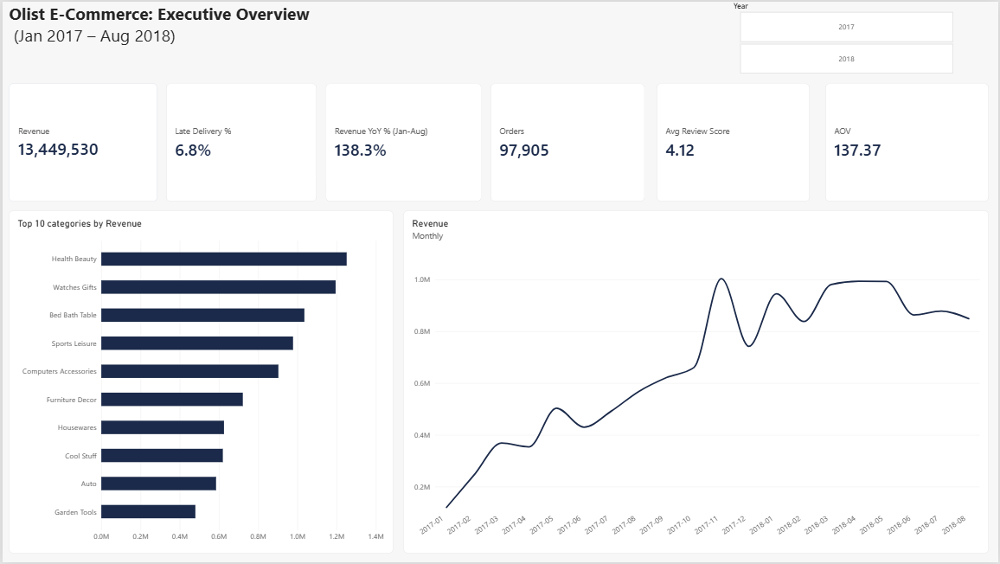
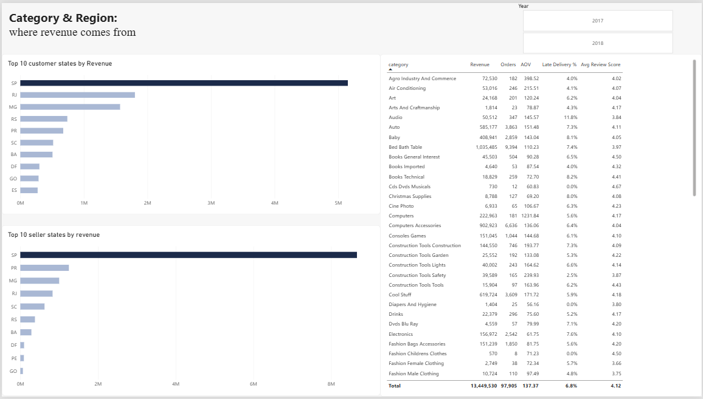
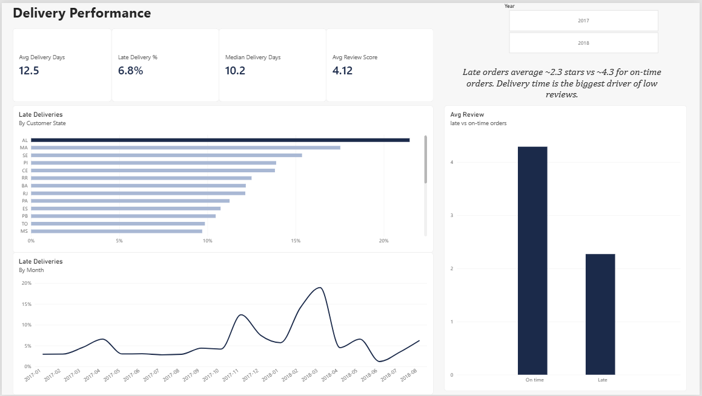

# Data Analysis (Olist E-Commerce)

An end-to-end analysis of about 100,000 Brazilian e-commerce orders (2017-2018): cleaning in Python, a star-schema model in SQL Server, a three-page Power BI dashboard, and an Excel cross-check of the totals.

## Business questions

1. How fast is revenue growing, and what drives it?
2. Which product categories and regions bring in the revenue?
3. How well does delivery perform, and does it affect customer reviews?

## Dashboard

**Executive overview**

**Category and region**

**Delivery performance**

## Key findings

- Jan-Aug revenue grew **138%** from 2017 to 2018 (R$3.08M to R$7.34M), driven by order volume. Average order value stayed near R$137.
- The **Southeast** brings in 65% of revenue, and the top five categories make up about 40%.
- **6.8%** of orders arrive late, and late orders average about **2.3 stars against 4.3** for on-time orders.
- Freight adds 21-26% to the item price in several Northeast states, against 13.8% in Sao Paulo, and deliveries there take 18-24 days.
- Only **3%** of customers place a second order.

The full write-up, with recommendations and the limits of the analysis (a 20-month window, no cost or margin data, associations rather than proof of cause), is in [docs/findings.md](docs/findings.md).

## Data

- **Source:** [Brazilian E-Commerce Public Dataset by Olist](https://www.kaggle.com/datasets/olistbr/brazilian-ecommerce) on Kaggle, 9 CSV tables.
- **License:** CC BY-NC-SA 4.0. The data belongs to Olist, and this project is for non-commercial portfolio use.
- **Not included:** the raw data is not stored in this repository. Download it from the link above to reproduce the work.

## Workflow

| Step | Tool | What I did |
|---|---|---|
| 1. Clean | Python (pandas, Google Colab) | Profiled and cleaned 8 tables, kept a log of every change, validated the result, exported clean files |
| 2. Model | SQL Server 2022 | Created tables, loaded the clean files with `BULK INSERT`, checked the load against Python, built a star schema with views |
| 3. Visualize | Power BI Desktop | Imported the views, built relationships and a date table, wrote DAX measures, designed three pages |
| 4. Cross-check | Excel | Rebuilt the revenue totals with a pivot table and used INDEX-MATCH to map states to regions |

The same headline numbers appear in Python, SQL, Power BI and Excel: **R$13,449,530 revenue, 97,905 orders, R$137.37 average order value**.

## Key decisions and assumptions

| Decision | Reason |
|---|---|
| Analysis window: Jan 2017 to Aug 2018 | 2016 and Sep-Oct 2018 have very few orders and would distort trends |
| Revenue is the item `price`, without freight | Freight is a pass-through cost to the customer, not product revenue |
| Canceled and unavailable orders are excluded from sales | They were not fulfilled |
| Flag problem rows instead of deleting them | Keeps the data traceable and lets the analysis choose what to exclude |
| Average order value is computed per order | Item prices are summed per order first, so multi-item orders are not counted per item |
| Customers are counted by `customer_unique_id` | `customer_id` changes with every order, so it overstates unique customers |
| Delivery time is reported as mean and median | A few extreme deliveries pull the mean up |
| Late = delivered after the estimated date | Matches how the customer experiences the promise |
| Year-over-year compares Jan-Aug only | 2018 has no data after August, so full years would not be comparable |

Cleaning details (28 logged steps) are in [notebook/cleaning_log.csv](notebook/cleaning_log.csv) and the notebook. Examples:

- ZIP prefixes had lost their leading zeros as integers, so they were converted to 5-character text.
- Geolocation had 1,000,163 rows. After removing duplicates and 33 coordinates outside Brazil, it was reduced to one row per ZIP (19,010 rows) using median coordinates.
- 249 of 98,665 orders have payments that differ from item price plus freight by more than 1. They are flagged, not changed, since the gap is most likely instalment interest.
- Reviews were reduced to one per order (98,673), and the comment text was left out because no measure uses it.
- 610 products with no category are labeled "Unknown". Two missing category translations were added and four spelling errors in the translation table were corrected.

## Data model

Two fact views and three dimension views, built in SQL Server and imported into Power BI:

- `vw_fact_order_items` (one row per item sold): price, freight, product, seller
- `vw_fact_orders` (one row per order): delivery days, late flag, review score, payment details
- `vw_dim_customer`, `vw_dim_product`, `vw_dim_seller`
- A `Date` table created in DAX

Items and orders are kept separate because delivery and reviews belong to the order, and putting them on the item table would count them once per item. The relationship between the two fact views filters in both directions, so category views can also show late rates and review scores.

## How to reproduce

1. Download the dataset from Kaggle and upload the CSVs to a Colab session.
2. Run the notebook. It exports the clean files and `cleaning_log.csv`.
3. In SQL Server, run the scripts in the `sql/` folder in order. Edit the folder path in the `BULK INSERT` statements to where you saved the clean files, and make sure the SQL Server service can read that folder.
4. Open the `.pbix` file in Power BI Desktop, then update the server name under **Transform data > Data source settings**.

## Tools

Python (pandas), SQL Server 2022 and SSMS (joins, aggregations, views), Power BI Desktop (DAX, star schema, three-page report), Excel (pivot tables, INDEX-MATCH).

## Author

Eman Aldahmashi
